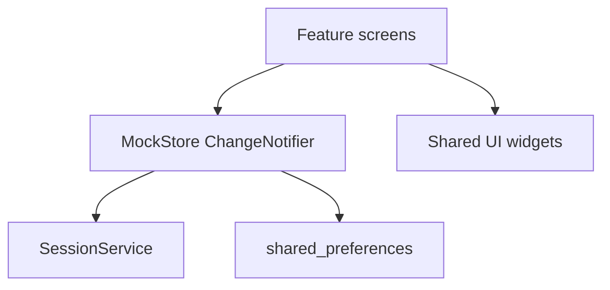

# UniLoop Project Summary

## Problem and users

UniLoop unifies project discovery, collaboration, mentorship, events, and
feedback for students, clubs, professors, alumni, industry clients, and
administrators.

## Architecture

The app uses feature-based folders, local dummy data, and StatefulWidget with
setState. MockStore is the seam for a future backend.

## Implemented areas

Authentication and role routing, student teams/workspace/Kanban/milestones,
project applications, industry applicants and hiring pipeline, club members,
professor mentees, alumni, and admin foundations.

## Mock integrations

Session metadata uses shared_preferences. Uploads, notifications, maps, AI,
and backend APIs remain local UI mocks.
